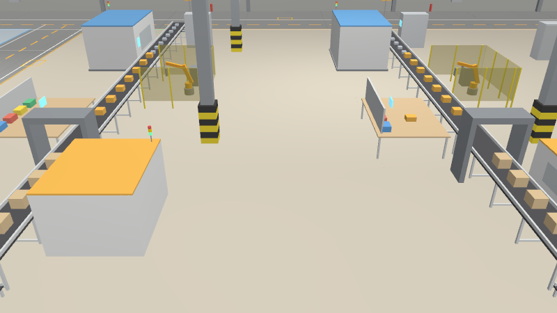
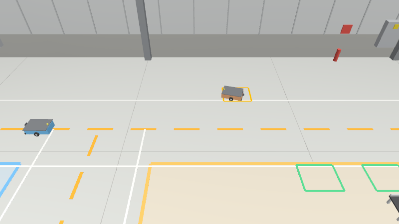

# AMR Fleet Harmonic Distribution - BẢN NHẸ (Lite)

> **Bản nhẹ** cho máy cấu hình vừa phải: nhà máy **90 m × 75 m**, **4 dây chuyền sản xuất + 4 dây chuyền đóng gói**,
> **5–8 AMR**, 4 dock sạc, các phần chuyển động (tay máy, thùng, sản phẩm) mỗi phần chỉ 1 draw call. Đo trên laptop
> RTX 4060: 6 robot + GUI Gazebo + RViz chạy **RTF ≈ 1.0**. Bản đầy đủ (140 × 75 m, 8 + 8 dây chuyền, 5–15 AMR) ở
> nhánh [`humble`](../../tree/humble) / [`jazzy`](../../tree/jazzy); hai bản phát triển độc lập.

Mô phỏng **đội 5–8 AMR** vận chuyển nội bộ trong một nhà máy hoàn chỉnh 90 m × 75 m, chạy trên
**ROS 2 Humble + Gazebo Harmonic** (Ubuntu 22.04), **Nav2 + AMCL** trên từng robot và **RViz2**. Hệ thống có:

> Nhánh **`lite-humble`**: ROS 2 Humble (Ubuntu 22.04) + Gazebo Harmonic. Bản nhẹ cho ROS 2 Jazzy (Ubuntu 24.04):
> nhánh [`lite-jazzy`](../../tree/lite-jazzy). Mã nguồn hai nhánh giống nhau (tự nhận bản ROS khi build / launch).

* **Nhà máy đầy đủ**: tường panel cách nhiệt, dải cửa sổ, cửa cuộn, cột thép, dầm mái, đèn (có nguồn sáng thật),
  sàn epoxy chia khu và vạch làn, kệ đầy thùng/bin linh kiện, kệ pallet thành phẩm, văn phòng 2 tầng, xe tải ở dock,
  bình cứu hoả, biển báo… và **8 dây chuyền**: 4 dây chuyền sản xuất + 4 dây chuyền đóng gói. Mỗi đầu dây chuyền
  có một work cell: tay máy trạm gắp thùng giữa AMR và **bệ 3 ô** cạnh dây chuyền, tay máy nạp liệu lấy **từng sản
  phẩm** trong thùng đặt lên băng tải thật, sản phẩm chạy qua quy trình rồi được xếp vào thùng trên bệ đầu ra và
  chính thùng đó được tay máy gắp lên AMR. Mọi thùng và sản phẩm trong Gazebo khớp đúng số liệu của MES.
* **Nav2 + AMCL trên từng robot**: AMCL định vị trên bản đồ cắt từ chính world Gazebo, `controller_server`
  (Regulated Pure Pursuit + local costmap từ lidar 2D và camera 3D) lái robot theo đoạn route được cấp quyền,
  `collision_monitor` dừng/giảm tốc theo lidar + camera 3D.
* **Fleet manager**: giao task theo MES mô phỏng, điều phối giao thông theo **hàng ưu tiên tính theo task**, robot
  ưu tiên thấp né rồi bám lại route cũ, gỡ deadlock, 4 dock sạc rải dọc trục chính, sạc luân phiên; số dây
  chuyền chạy tự điều chỉnh theo số robot (`active_lines: auto`).
* **Dashboard web** (http://localhost:8081): robot số mấy đang làm gì, đi route nào, ETA, task tiếp theo, hàng ưu
  tiên, pin, đang chờ hoặc nhường ai; bản đồ trực tiếp, 8 dây chuyền, trạm sạc, hàng đợi task, nhật ký điều phối.


| Gazebo Harmonic: toàn cảnh nhà máy | Gazebo: dây chuyền sản xuất / đóng gói, sản phẩm chạy trên băng tải |
|---|---|
|  |  |

| Gazebo + Nav2: AMR chở thùng SP (khay nâng) rời B3_OUT sang dây chuyền đóng gói | Gazebo + Nav2: AMR-02 (P2) né vào yield bay trên Đường Bắc 2 chiều, AMR-01 (P1) đi qua, sau đó AMR-02 bám lại route cũ |
|---|---|
|  |  |


| Yêu cầu | Cách đáp ứng |
|---|---|
| Fleet ≥ 10–15 AMR | `num_robots:=12` (mặc định), 30 chỗ đỗ nên tối đa 30 robot. Đã kiểm thử 10/12/15 robot (mô phỏng headless 30 phút) và Gazebo + Nav2 với 2–3 robot (container không GPU) |
| Trạm sạc tự động cho cả đội | 4 dock (CH1–CH4) dọc phía Bắc trục chính, giữa các đầu ra dây chuyền; hàng đợi sạc, sạc tranh thủ luân phiên (≤ 40 % đội đi sạc cùng lúc), nhường dock cho robot pin thấp |
| Nhà máy rộng, 5 khu | Khu A kho linh kiện (5 trạm cấp) · Khu B **4 dây chuyền sản xuất** · Khu D **kho thành phẩm** (2 trạm nhập kho, 2 trạm xuất kho) · Khu C **4 dây chuyền đóng gói** · Khu G **3 cổng xuất hàng** có xe tải |
| Mô phỏng cả dây chuyền | 4 + 4 dây chuyền, mỗi dây có đủ trạm máy và 2 work cell (xem mục 2). System `FactoryLines` vẽ đúng từng thùng, từng sản phẩm theo MES: gắp thùng lên bệ, nạp từng SP lên băng, SP đổi dạng qua quy trình, xếp vào thùng đầu ra |
| Map nhà máy đầy đủ (tường, sàn, hàng hoá, đèn…) | World sinh từ layout: ~5000 chi tiết (gộp thành mesh để render nhanh), 15 đèn điểm + đèn trần phát sáng. Bản đồ AMCL cắt đúng ở độ cao lidar |
| Chu trình sản xuất | A (kit linh kiện) → B_IN → dây chuyền SX → thành phẩm xếp **thùng 16 SP** ở B_OUT → **nhập kho D** → **xuất kho D** → C_IN → đóng gói từng SP → C_OUT → **cổng xuất G → xe tải** |
| Chạy Nav2 và AMCL | Mỗi robot: AMCL + controller_server + collision_monitor (+ planner/behavior/bt_navigator nếu `nav2_full_stack:=true`), một map_server chung |
| 2 bánh chủ động + 4 bánh tự do, lidar 2D, camera 3D | URDF `amr_description`: diff-drive, 4 caster, một `gpu_lidar` **270°** ở mặt trước, `rgbd_camera` (ảnh + depth + point cloud) |
| Xem robot số mấy làm gì, route nào, ETA, task tiếp theo | Dashboard web, nhãn trong RViz, `fleet_cli status`, topic `/fleet/state` |
| Hàng ưu tiên **theo task**; gặp nhau thì robot ưu tiên thấp né rồi bám lại route cũ | `priority_mode: task` (mặc định): mức khẩn của task (theo trạng thái dây chuyền) → đang chở hàng → task chờ lâu. Robot ưu tiên thấp tránh vào yield bay, chờ robot ưu tiên cao đi qua rồi nhập lại **route cũ** |

---

## 1. Kiến trúc

```
              ┌──────────────────────────────── amr_bringup ─────────────────────────────────┐
              │ factory_layout.yaml (nguồn dữ liệu duy nhất) · fleet_params.yaml · nav2_amr.yaml │
              └───────┬───────────────────────────┬──────────────────────────────┬────────────┘
                      │ generate_world             │                              │
   Gazebo Harmonic ◄──┤ world SDF + mesh           │ bản đồ AMCL (cắt ở           │ đồ thị giao thông
   ├ nhà máy + 8 dây chuyền (FactoryLines)          │ độ cao lidar)                │
   ├ N × AMR (URDF: diff-drive, lidar, RGB-D,       ▼                              ▼
   │   khay nâng hàng)                          map_server ──/map──► AMCL     fleet_manager
   └ ros_gz_bridge ──scan, odom, points──►     ┌──────── Nav2 / robot ───────┐ ├ MES mô phỏng → task
          ▲            /tf (odom→base)         │ AMCL: map → amr_XX/odom      │ ├ giao task + "task tiếp theo"
          │ cmd_vel                            │ controller_server (RPP +     │ ├ traffic control: đặt chỗ node,
          │ cargo_lift                         │   local costmap lidar+RGB-D) │ │  ưu tiên theo task, né + bám
          │ /factory/line_state                │ collision_monitor            │ │  lại route cũ, gỡ deadlock
          │                                    │   cmd_vel_nav → cmd_vel ─────┼─┘ ├ pin / trạm sạc 4 dock
          │                                    └──────────▲───────────────────┘   └ /fleet/state, markers …
          │                                               │ FollowPath (đoạn route       │
          │                                               │ đã cấp quyền) + speed_limit  │
          │                                     robot_agent × N ◄──/amr_XX/fleet/route──┘
          │                                     (pose AMCL, pin, khay nâng) ──status──►
          │                                               RViz2 ◄── /fleet/markers, Nav2 topics
          └────────────────────────────────────── dashboard (web :8081) ◄── /fleet/snapshot_json
```

**Phân vai Nav2 ↔ fleet manager.** Fleet manager quyết định robot được đi *đâu* và *tới đâu* (đặt chỗ node trên đồ
thị làn, ai nhường ai). `robot_agent` biến đoạn route đã được cấp quyền thành `nav_msgs/Path` dày (0.1 m) và gửi cho
`controller_server` qua action **FollowPath**; mỗi khi quyền đi được nới thêm thì path được gửi lại (preempt) nên robot
chạy liên tục, không dừng ở từng node. Tốc độ giới hạn của làn (1.5 m/s trên làn, 0.65 m/s trong lay-by/dock) gửi qua
topic `speed_limit` của Nav2; khi đoạn được cấp quyền kết thúc trước đích, agent giảm tốc sớm và êm (0.6 m/s²) theo
quãng đường còn lại thay vì chạy hết tốc rồi phanh gấp, nên thường quyền đi được nới trước khi robot phải dừng. Vị trí robot là ước lượng AMCL. Lidar + camera 3D vào local costmap (RPP tránh va chạm)
và `collision_monitor` (vùng dừng 0.3 m, vùng giảm tốc 0.85 m trước robot).

| Package | Nội dung |
|---|---|
| `amr_fleet_msgs` | Message/service: `RouteCommand`, `RobotStatus`, `RobotState`, `FleetState`, `TaskInfo`, `ProductionState`, `FleetEvent`, `SubmitTask`, `SetRobotPriority` |
| `amr_description` | URDF/xacro của AMR + plugin Gazebo (DiffDrive, OdometryPublisher, JointStatePublisher, JointPositionController cho khay nâng, gpu_lidar, rgbd_camera) |
| `amr_gazebo` | System C++ `FactoryLines` (work cell 2 đầu dây chuyền: tay máy, thùng trên bệ, từng sản phẩm trên băng theo MES), launch Gazebo: sinh world + bản đồ từ layout, spawn N robot, một `ros_gz_bridge` chung; world/mesh/bản đồ dựng sẵn |
| `amr_fleet_manager` | Lõi điều phối (Python thuần, có unit test), node ROS: `fleet_manager`, `robot_agent` (driver `nav2` hoặc `simple`), `kinematic_sim`, `dashboard`, công cụ `fleet_cli`, `headless_sim`, `generate_world`, `rviz_config` |
| `amr_bringup` | `bringup.launch.py`, `navigation.launch.py` (Nav2 + AMCL cả đội), `fleet.launch.py`, layout nhà máy, tham số |

Lõi `amr_fleet_manager/core` **không phụ thuộc ROS**: cùng một mã được dùng trong node ROS, trong mô phỏng headless và
trong unit test.

## 2. Nhà máy và chu trình sản xuất

```
 y=75 ┌──────── tường panel · cửa sổ · cửa cuộn phía Bắc (xe tải) ────────────────┐ văn
      │P ═ Đường Bắc y=70: 2 làn 1 chiều ═ A4 ═ A5 ═ B1_IN  B2_IN  B3_IN  B4_IN ═ │ phòng
      │P   ┌ Khu A: kho linh kiện ┐  ┆  ┌─ Khu B: 4 dây chuyền SẢN XUẤT ──────┐   │ 2
      │A3  │ 5 kệ đầy bin/thùng    │  ┆  │ B1    B2    B3    B4  (x 43…76)     │   │ tầng
      │A1  └───────────────────────┘  ┆  └ CH1 B1_OUT CH2 B2_OUT B3_OUT CH3 B4_OUT CH4
      │ ═══ Trục chính y=36: 2 làn ═ DI1 DI2 DO1 DO2 ═ C1_IN  C2_IN  C3_IN  C4_IN │
      │P   ┌ Khu D: kho thành phẩm┐  ┆  ┌─ Khu C: 4 dây chuyền ĐÓNG GÓI ──────┐  P│
      │P   │ 5 kệ pallet           │  ┆  │ C1    C2    C3    C4  (x 45…78)     │  P│
      │P   └───────────────────────┘  ┆  └ C1_OUT  C2_OUT  C3_OUT  C4_OUT ─────┘  P│
      │ ═══ Đường Nam y=5: 2 làn ═ G1 ═ G2 ═ G3 (cổng xuất hàng) ═══════════════════ │
 y=0  └ x=0 ─ Đường Tây ─ [cửa G1 G2 G3, xe tải] ─ Trục giữa x=35 ─ Đường Đông x=85 ┘ x=90
```

* **Làn 1 chiều theo luật đi bên phải** (Đường Nam, Trục chính, Đường Bắc, Đường Tây, Đường Đông): hai làn cách nhau 2 m nên
  không có đối đầu. Sàn chỉ sơn vạch giữa làn (không vẽ mũi tên).
* **Cắt làn linh hoạt** (`crossover_spacing: 2`, `crossover_cost`, `crossover_gap` trong `traffic:`): trên mọi đường
  2 làn, robot có thể cắt sang làn ngược chiều **ở bất kỳ điểm nào** (mỗi nút làn, cách 2 m) khi đích nằm phía sau,
  thay vì chạy vòng cả dãy. Bộ lập đường cộng thêm 8 s cho mỗi lần cắt nên robot chỉ cắt khi lợi rõ; bộ quản lý giao
  thông giữ chỗ đoạn cắt như mọi cạnh khác và bắt robot **chờ khoảng trống**: không robot nào trên làn đích đang đi
  tới điểm cắt trong vòng 8 m, nên xe đang chạy thẳng không phải dừng vì xe quay đầu. Mô phỏng headless 60 phút (SP
  xuất hàng / giờ; không cắt → cố định 20 m → linh hoạt): bản nhẹ 5 robot 448 → 480 → 544, 8 robot 640 → 688 → 704;
  bản chính 9 robot 720 → 784 → 800, 15 robot 960 → 1120 → 1200; 0 va chạm, số lần dừng/km tương đương cách 20 m.
* **Làn 2 chiều** (Trục giữa x=35, Ngõ x=84) có **yield bay** (ô tránh) dọc làn: đây là nơi robot gặp
  nhau đối đầu và robot ưu tiên thấp phải né.
* **Trạm** là lay-by cạnh làn: `làn → Q (ô chờ) → S (ô phục vụ) → làn`. Robot chờ trạm đứng ở Q, không chặn làn.
  Dock sạc và ô đỗ là ngõ cụt cạnh làn.

**Sản phẩm: động cơ điện mini**, lắp từ linh kiện rồi đóng hộp (`tools/line_products.py`, mỗi dạng là một mesh
một vật liệu trong `meshes/item_*.obj`):

| Dây | Trạm 1 | Trạm 2 | Trạm 3 | Trạm 4 |
| --- | --- | --- | --- | --- |
| Sản xuất (B) | đế + chân → ép **stator** có cánh tản nhiệt | lắp **trục**, then, nắp trước, nắp ổ bi | nắp sau, **chụp quạt**, **hộp đấu dây**, đầu cáp | **cổng QC**: nhãn máy + tem QC → động cơ hoàn chỉnh |
| Đóng gói (C) | bọc **xốp** hai đầu | đặt vào **hộp** có đai màu | gập nắp, dán **băng keo**, logo | in + dán **nhãn mã vạch** |

**Băng tải vòng khép kín** (over-under, cả dây SX và dây đóng gói): sản phẩm nằm trên **khay gá** (jig) có chốt định
vị, khay chạy trên 2 dải băng của tầng trên giữa hai ray dẫn hướng, qua các trạm có vỏ che (đèn tháp, HMI, chặn khí
nén). Ở cuối dây, tay nạp liệu nhấc SP khỏi khay; **thang nâng đầu ra** (bàn nâng là một đoạn băng ngắn) hạ khay rỗng
xuống **băng hồi** ở tầng dưới (0,44 m); khay chạy về đầu dây (0,5 m/s) và **xếp hàng cách nhau 0,24 m** (băng tích
khay: khay về sau dừng sau khay cuối, cả hàng nhích lên khi thang nâng hạ xuống). **Thang nâng đầu vào** đưa khay
đầu hàng lên ngang mặt băng đúng lúc tay nạp liệu đặt SP mới. Khung thang nâng thấp hơn mặt băng, phía trên điểm
giao nhận không có cột/dầm nào nên tay máy không va. Số khay mỗi dây đủ cho mọi SP trên băng + khay trên đường về.

Dây sản xuất còn có trạm CNC, tủ điều khiển, cell robot hàn (có hàng rào an toàn), bàn lắp ráp, máy xếp thùng; dây
đóng gói có máy quấn màng (flow wrapper), case packer, robot xếp pallet.

**Work cell ở hai đầu mỗi dây chuyền** (system `FactoryLines`, mục `CELL_*` trong `core/layout.py`): bệ 3 ô xếp
thành **một hàng song song với làn**, **tay máy trạm** (cam) đứng phía AMR, **tay máy nạp liệu** (xanh, nhỏ hơn 15 %)
đứng phía băng tải, xe chồng thùng gấp bên cạnh. Mỗi tay chỉ làm việc trong nửa ô của mình; khi phải xoay xa, tay
máy rút công cụ về gần chân rồi mới xoay, sau đó vươn ra (không quét ngang qua tay kia). Tay nạp liệu chỉ làm với
thùng đang mở, tay máy trạm chỉ làm với các ô khác. `tools/cell_clearance.py` (và test `test_cell_clearance`) mô
phỏng lại mọi động tác của hai tay: khe hở nhỏ nhất ≈ 5 cm (bố trí cũ: chồng lấn 23 cm), mọi điểm gắp/đặt đều với tới.

* Đầu vào: tay máy trạm gắp thùng (kit linh kiện / thùng SP chưa đóng gói) từ AMR đặt lên ô trống của bệ. Thùng cũ
  nhất được mở, tay nạp liệu gắp **từng sản phẩm** (mỗi nhịp 22 s / 21 s một SP) đặt lên băng tải. Thùng rỗng được
  tay máy trạm bỏ vào xe thùng gấp.
* Trên băng: SP nằm trên khay gá chạy từ đầu tới cuối dây chuyền (0.2 m/s) và đổi dạng sau mỗi trạm (bảng trên):
  bộ linh kiện → động cơ hoàn chỉnh (dây SX), động cơ → hộp có nhãn mã vạch (dây đóng gói).
* Đầu ra: tay nạp liệu xếp từng SP vào thùng mở trên bệ; đủ 16 SP thùng được đóng lại và chờ trên ô của nó; tay máy
  trạm gắp **chính thùng đó** lên AMR, rồi lấy thùng mới từ xe thùng gấp đặt vào ô trống.

MES gửi trạng thái từng dây chuyền 4 lần/giây trên `/factory/line_state` (`"B1=run,in,open,fill,out|tuổi SP…"`),
nên số thùng trên bệ, số SP trong thùng và vị trí từng SP trên băng trong Gazebo luôn khớp số liệu MES. Sản phẩm
có đồng hồ riêng trong Gazebo (cập nhật vị trí 120 lần/giây): bản tin MES chỉ thêm SP mới / bỏ SP đã xếp thùng, còn
khi lệch quá 0,3 s thì dây chuyền chạy nhanh/chậm hơn tối đa 25 % cho tới khi khớp, SP không bao giờ giật lùi.

**Công nhân đi lại trong nhà máy** (Gazebo, system `amr_pedestrians`, mục `people:` trong layout): 8 người mặc áo
phản quang, đội mũ bảo hộ, đi bộ ~1 m/s, tay chân đung đưa theo bước đi, dừng làm việc ở các điểm trên tuyến:
2 người lấy hàng giữa các dãy kệ khu A và D, 8 người vận hành dọc hành lang giữa các dây chuyền B và C, 1 người vận
chuyển vật tư băng qua trục chính, 1 giám sát đi vòng cắt qua ngõ x = 84. Lối đi bộ không sơn vạch, chỉ chỗ cắt
làn AMR có vạch qua đường (zebra). Fleet manager không lập kế hoạch quanh họ: lidar 270° thấy chân, camera 3D thấy cả
người, nên `collision_monitor` của Nav2 giảm tốc / dừng AMR khi có người phía trước. Người đứng chờ khi một AMR đang
chạy tới gần và quay lại nếu AMR đứng chắn lối đi quá lâu (không bao giờ kẹt cứng người ↔ robot). Vị trí từng người
có trên `/factory/people` (`geometry_msgs/PoseArray`) và trong RViz. Tắt bằng `people:=false`.

**Chu trình (MES mô phỏng, `process:` trong layout):**

1. `KIT_DELIVERY` A1–A5 → B*_IN: thùng kit linh kiện (16 bộ) cho dây chuyền sản xuất (tối đa 2 thùng chờ trên bệ).
2. Mỗi dây chuyền B bắt đầu 1 SP sau mỗi `cycle_time` (22 s, nhịp); SP cần `loader_time` + chiều dài băng /
   `belt_speed` + `drop_time` (≈ 113 s) để đi hết dây chuyền rồi được **xếp vào thùng** (16 SP/thùng) ở B*_OUT.
   Thùng đầy chờ trên bệ (tối đa 2); khi bệ đầy và thùng đang xếp cũng đầy thì cả dây chuyền dừng (`BLOCKED`).
3. `FG_STORE` B*_OUT → DI1/DI2: **nhập kho thành phẩm** (thùng đầy nhất đi trước, trạm ít robot nhất). Robot từ
   B_OUT (làn đi về Tây) quay đầu ở Đường Tây rồi chạy về Đông qua DI → DO → các C_IN: nhập kho xong có thể lấy
   ngay thùng ở trạm xuất kho cách 6–18 m, không vòng.
4. `FG_PICK` DO1/DO2 → C*_IN: **xuất kho** cho dây chuyền đóng gói thiếu hàng nhất. Kho (`warehouse:`) đếm theo
   thùng: có sẵn hàng lúc khởi động (`initial_stock`) để dây đóng gói chạy ngay, kho đầy (`capacity`) thì dây SX
   phải chờ, kho trống thì dây đóng gói chờ — kho là bộ đệm giữa sản xuất và đóng gói.
5. Dây chuyền C **đóng gói từng sản phẩm** (`pack_time` 21 s/SP) và xếp vào thùng xuất hàng (16 SP).
6. `SHIPMENT` C*_OUT → G1–G3: **xuất hàng** ra cổng ở tường Nam; xe đủ `truck_capacity` (24 thùng) thì xuất
   bến và xe mới (rỗng) vào.

**Cổng xuất hàng** (station `ship_dock`, mục `GATE_*` trong `core/layout.py`): một tay máy trạm gắp thùng từ AMR đặt
lên đầu băng tải dock; băng tải chạy qua cửa cuốn đang mở, qua sàn dock tới đuôi xe, rồi **cần băng tải ống lồng**
(3 đoạn lồng nhau) vươn vào trong thùng xe tới mặt chồng hàng; thùng được đặt lên chồng hàng xếp từ vách đầu xe ra
cửa sau (mỗi hàng 4 thùng ngang × 3 tầng). Thùng xe tải rỗng, mở cửa sau, nên nhìn thấy từng thùng được xếp vào; số
thùng trong xe khớp số đếm của MES (`"G1=n"` trên `/factory/line_state`). Xe đầy thì sau 4 s được thay bằng xe rỗng.

Cổng xuất đặt ở tường Nam trước kho D: robot từ C_OUT quay đầu ở Đường Tây (~69 m) nhưng sau đó chỉ cách kho linh
kiện ~85 m; cổng ở phía Đông Trục giữa gần dây đóng gói hơn (~35 m) nhưng chuyến rỗng về kho linh kiện ~165 m.

**Số dây chuyền chạy theo số robot** (`active_lines: auto`, `robots_per_line: 1.5`): MES chạy ceil(số robot online / 1.5)
cặp dây chuyền, ưu tiên các dây phía Tây (gần kho A/D và cổng xuất). 4 robot → 3 cặp, 5–8 robot → cả 4 cặp. Dây bị tắt chạy
hết hàng đang có rồi nghỉ (không nhận kit / thùng mới). Thêm robot thì bật ngay; bớt robot thì tắt sau 20 s.

Năng lực (mô phỏng headless, 60 phút sau 10 phút khởi động; SP **đã xuất lên xe tải**): 5 robot ≈ 450 SP/giờ,
6 ≈ 560, 7 ≈ 580, 8 ≈ 640 (4 dây chuyền gần kín công suất 4 × 163.6 SP/giờ). Chặng kho thêm 1 chuyến cho mỗi thùng
(4 chuyến thay vì 3), nhưng **thùng 16 SP** giảm số chuyến AMR trên mỗi SP đi 1/4 nên năng suất bằng hoặc hơn luồng cũ
(437 / 509 / 588 / 648). `robots_per_line` 1.5 tốt hơn 2.0 và 2.5.

Khi khởi động, các dây chuyền đã có sẵn bán thành phẩm (`initial_wip`) nên mọi dây chạy ngay, không phải chờ robot
chở chuyến đầu.

## 3. Robot AMR

| Thành phần | Thông số |
|---|---|
| Kích thước | 0.80 × 0.46 m thân (footprint Nav2 0.85 × 0.60 m), 45 kg |
| Truyền động | 2 bánh chủ động Ø160 mm ở giữa thân (vi sai, cách nhau 0.52 m) + **4 bánh tự do** ở 4 góc |
| Lidar 2D | Một `gpu_lidar` **270°** (±135°) giữa mặt trước, cao 0.20 m, 541 tia (0.5°), 0.08–20 m, 10 Hz → `/amr_XX/scan`. Thân xe có **khe quét** ở dải 0.17–0.23 m (lùi vào tới x = 0.18 m) nên tia ±135° đi dọc hai bên hông xe mà không chạm thân, như AMR thật |
| Camera 3D | `rgbd_camera` 320×240, 5 Hz → `/amr_XX/camera/{image,depth_image,points,camera_info}` |
| Odometry | DiffDrive (odometry bánh xe, có trôi như robot thật) → `/amr_XX/odom` + TF `amr_XX/odom → amr_XX/base_footprint`; vị trí thật giữ ở `/amr_XX/ground_truth` để đối chiếu |
| Định vị | AMCL (likelihood field, 300–1500 hạt) trên `/map`, phát TF `map → amr_XX/odom` |
| Khay hàng | Khớp tịnh tiến `cargo_joint`: khi robot chở hàng, kiện hàng nâng lên sàn xe (`/amr_XX/cargo_lift`); khi không chở, kiện hàng hạ xuống dưới sàn để không cắt mặt phẳng lidar |
| Tốc độ | 1.5 m/s trên làn, 0.65 m/s trong lay-by/dock, quay tại chỗ khi lệch hướng lớn |
| An toàn | `collision_monitor`: vùng dừng 0.30 m, vùng giảm tốc 0.85 m trước robot, từ lidar + point cloud camera |

## 4. Điều phối giao thông (cốt lõi)

Mỗi chu kỳ 10 Hz, `core/traffic.py` và `core/fleet.py` làm các bước sau:

1. **Ô đang giữ (held)**: node robot đang đứng, node nó đang đi tới và mọi node robot không kịp phanh trước đó. Đây
   là khoá cứng, robot nào giữ thì robot đó sở hữu.
2. **Cấp quyền đi (grant)** cho từng robot **theo thứ tự ưu tiên giảm dần**: cấp tiếp từng node dọc route (khoảng
   7 m phía trước). Một node chỉ trống khi mọi node trong bán kính 1.3 m và mọi node bị cạnh đi quét qua đều không
   thuộc robot khác. **Giao lộ được cấp nguyên khối** gồm cả node ra khỏi giao lộ, nên không robot nào dừng giữa
   giao lộ.
3. **Tránh nhau trên làn 2 chiều (không dừng, bám path)**: hai robot chạy ngược chiều trên cùng một làn 2 chiều
   (Đường Bắc, Trục giữa, Ngõ) được ghép cặp từ ~16 m, nên quyền đi của chúng không chặn nhau và không robot nào
   phải phanh. Khi còn cách nhau **8 m**, cả hai **lệch sang phải 0.7 m** ngay trên route của mình (waypoint dịch
   ngang, giảm nhẹ còn 1.1 m/s, robot ưu tiên thấp 0.9 m/s), đi qua nhau cách ~1.4 m rồi trở về tâm làn và tăng tốc
   lại. Node nào của làn 2 chiều đủ chỗ cho hai xe lệch (cách mọi vật ≥ 0.55 m) được tính sẵn khi dựng đồ thị.
   Nhật ký: `amr_02 và amr_04 gặp nhau trên Duong Bac 2 chieu (cách 7.9 m): cùng lệch phải để tránh, không dừng`.
4. **Đồ thị chờ (wait-for)** (dự phòng): robot nào đang bị robot nào chặn.
   * **Đối đầu / deadlock vòng** (A chờ B, B chờ A, hoặc vòng dài hơn): robot **ưu tiên thấp nhất** trong vòng né.
   * **Chặn ưu tiên**: robot ưu tiên cao bị một robot ưu tiên thấp đang đứng yên chặn quá 3 s thì robot thấp nhường.
5. **Né đường** (dự phòng, khi kẹt thật sự): tìm nơi tránh gần nhất (yield bay, ô đỗ trống hoặc làn khác) nằm **ngoài lộ trình sắp tới** của
   robot ưu tiên cao, còn trống theo đúng luật cấp quyền. Robot thấp vào đó, chờ robot ưu tiên cao đi qua. Nếu
   không né được (hai bên đều kẹt), hai robot **đổi vai**: robot kia lùi vào chỗ tránh.
6. **Bám lại route cũ**: từ chỗ tránh, chọn node trên **route ban đầu** sao cho (đường quay lại + phần route cũ còn
   lại) ngắn nhất, rồi tiếp tục đúng route và nhiệm vụ cũ, ví dụ log:
   `amr_05 bám lại route cũ tại north.16 → tiếp tục đi tới điểm lấy hàng`.
7. **Đổi lộ trình**: robot bị kẹt quá 20 s được lập lại đường đi tránh vùng tắc. A* phạt các node đang có robot
   đứng, nên robot chủ động đi vòng chỗ đông.

### Hàng ưu tiên theo task (`priority_mode: task`, mặc định)

Mức ưu tiên đi theo **task** robot đang làm, không theo số hiệu robot:

```
mức task  = MES tính lại liên tục:  HIGH (2) khi dây chuyền task phục vụ sắp thiếu đầu vào, đầu ra đã đầy
            hoặc máy đóng gói đang đói;  NORMAL (1) bình thường;  task thủ công giữ mức người tạo chọn (0..3)
điểm      = 1000·(mức task + 1)
          + 400                         nếu đang chở hàng của task (đã lấy hàng)
          + 0.5·tuổi task (tối đa 300)  task chờ lâu được ưu tiên hơn
robot không có task: 0 · đi sạc: 300 · đi sạc khi pin < 15 %: 3500 (cao nhất)
hoà điểm: phân xử theo hạng cơ bản (amr_01 = 1, đổi được trên dashboard)
```

Hạng P1..Pn hiển thị trên dashboard/RViz là hạng dùng để quyết định ai nhường. Thời gian chờ chỉ cộng thêm khi cấp
quyền qua giao lộ (chống "chết đói"), không làm lật kèo né đường. Hai chế độ cũ vẫn còn: `priority_mode:=dynamic`
(task + hạng cơ bản + thời gian chờ) và `priority_mode:=static` (chỉ hạng cơ bản).

## 5. Pin và trạm sạc

**Vào dock chính xác (Nav2 `opennav_docking`).** Route của robot đi sạc kết thúc ở node dock của trạm (điểm chờ /
staging). Agent gọi `DockRobot` cho `docking_server` của robot: server tự lái 0.5 m cuối cho tới khi cản trước chạm
tấm tiếp điểm của bộ sạc. Vị trí dock được agent **phát hiện từ lidar** (fit mặt phẳng rộng 0.8 m của bộ sạc trong
scan 270°, `core/docking.py`) và gửi lên `detected_dock_pose`, nên độ chính xác không phụ thuộc sai số AMCL. Thử trong
Gazebo: AMCL lệch 8 cm nhưng robot vẫn dừng cách vị trí dock đúng 1.5 cm. Khi có lệnh mới, agent gọi `UndockRobot`
(lùi về điểm chờ) trước khi đi tiếp. Nếu dock thất bại 2 lần, robot sạc tại điểm chờ.

* Pin được mô phỏng trên robot (`robot_agent`): tiêu hao khi đứng yên và khi chạy, sạc 0.25 %/s trên dock.
* Pin < 30 %: làm xong task hiện tại rồi đi sạc, huỷ "task tiếp theo" nếu có. Pin < 15 % khi đang chạy rỗng: trả
  task về hàng đợi rồi đi sạc ngay.
* Rảnh và pin < 50 % mà có dock trống gần thì **sạc tranh thủ**. Robot sạc tranh thủ nhường dock cho robot pin thấp,
  và được gọi đi làm task khi pin ≥ 60 % (robot vào sạc vì pin thấp thì phải ≥ 80 %).
* Hết dock trống: robot vào **hàng đợi sạc** (ưu tiên pin thấp nhất) và chờ ở bãi đỗ gần trạm sạc.

## 6. Cài đặt

Ubuntu 22.04 + ROS 2 Humble + Gazebo Harmonic (không cần nâng lên 24.04):

```bash
# Gazebo Harmonic từ packages.osrfoundation.org
sudo curl https://packages.osrfoundation.org/gazebo.gpg -o /usr/share/keyrings/pkgs-osrf-archive-keyring.gpg
echo "deb [arch=$(dpkg --print-architecture) signed-by=/usr/share/keyrings/pkgs-osrf-archive-keyring.gpg] \
  http://packages.osrfoundation.org/gazebo/ubuntu-stable $(lsb_release -cs) main" | \
  sudo tee /etc/apt/sources.list.d/gazebo-stable.list
sudo apt update && sudo apt install gz-harmonic
sudo apt install ros-humble-desktop ros-humble-xacro ros-humble-navigation2 ros-humble-nav2-rviz-plugins \
     ros-humble-robot-state-publisher python3-colcon-common-extensions
# ros_gz cho Harmonic: ros-humble-ros-gzharmonic, hoặc build ros_gz nhánh humble với GZ_VERSION=harmonic
# docking: ros-humble-opennav-docking ros-humble-opennav-docking-msgs, hoặc build opennav_docking nhánh humble
mkdir -p ~/amr_ws && cd ~/amr_ws
git clone -b lite-humble https://github.com/b4lanc3/AMR-fleet-harmonic-distribution.git src/AMR-fleet-harmonic-distribution
source /opt/ros/humble/setup.bash
colcon build --symlink-install
source install/setup.bash
```

`amr_gazebo` biên dịch system C++ `FactoryLines` (work cell, thùng, sản phẩm) và `Pedestrians` (gz-sim 8); hook môi trường tự thêm
`GZ_SIM_SYSTEM_PLUGIN_PATH` và `GZ_SIM_RESOURCE_PATH` khi `source install/setup.bash`.

Trên Humble: `amr_gazebo` tự dùng thư viện hệ thống gz-sim 8 khi không có gói `*_vendor`, `navigation.launch.py` tự
đổi tham số `collision_monitor` sang định dạng Nav2 1.1 khi `ROS_DISTRO=humble` (points dạng mảng phẳng,
`max_points`, một `source_timeout` chung), docking dùng `opennav_docking_msgs` của bản backport. Khác biệt còn lại:
không có EventsExecutor của rclpy (tự lùi về SingleThreadedExecutor) và collision_monitor không phát
`collision_monitor_state` (trường `obstacle_stop` trên dashboard luôn false).

**Chạy nhanh trên máy này** (Humble + Harmonic, GPU NVIDIA): `~/AMR-Fleet-Lite/run_lite.sh [số robot]`
(mặc định 6, có cửa sổ Gazebo + RViz, dashboard http://localhost:8081), tắt bằng `~/AMR-Fleet-Lite/stop_lite.sh`
(chỉ tắt tiến trình của bản nhẹ: biến môi trường `AMR_LITE=1`). Workspace, DDS domain (43), partition Gazebo
(`amr_lite`) và thư mục world tạm (`/tmp/amr_fleet_lite`) riêng, không đụng tới bản đầy đủ.
`sim_env.bash` tách DDS của mô phỏng khỏi robot thật (CycloneDDS chỉ trên loopback, `ROS_DOMAIN_ID=43`). GUI Gazebo
được mở sau khi spawn xong cả đội (mở cùng lúc thì GUI bỏ sót robot spawn trong lúc nó đang nạp world).

**Work cell ở đầu dây chuyền** (system `amr_factory_lines`): mỗi trạm `*_IN` / `*_OUT` có bệ 3 ô, một tay máy trạm 6
trục (AMR ↔ bệ) và một tay máy nạp liệu (bệ ↔ băng tải). Tay máy trạm đồng bộ với AMR qua `/<amr>/cargo_lift` và báo
bàn giao trên `/factory/station_handover`; tay máy nạp liệu và từng sản phẩm được đặt theo tuổi sản phẩm mà MES gửi
trên `/factory/line_state`. Mọi khâu, thùng, sản phẩm là model tĩnh chỉ có hình, đặt pose bằng động học ngược nên
không tốn vật lý (nhưng camera / lidar của robot vẫn phải render chúng).

**Gazebo Jetty**: các system dùng tên `gz-sim-*-system` và thẻ `gz_frame_id` giống Harmonic, nên chỉ cần build
workspace trên bản ROS 2 đi kèm Jetty (`ros_gz`, `gz_sim_vendor` tương ứng). Không cần sửa mã.

## 7. Chạy

```bash
# Gazebo Harmonic + Nav2/AMCL từng robot + RViz + dashboard, 12 robot
ros2 launch amr_bringup bringup.launch.py num_robots:=12

# 15 robot, không mở GUI Gazebo (vẫn render cảm biến)
ros2 launch amr_bringup bringup.launch.py num_robots:=15 gui:=false

# Nav2 đầy đủ (thêm planner_server, behavior_server, bt_navigator cho mỗi robot)
ros2 launch amr_bringup bringup.launch.py nav2_full_stack:=true

# Không Nav2: bộ bám đường có sẵn trên odometry ground truth (nhẹ hơn)
ros2 launch amr_bringup bringup.launch.py navigation:=simple

# Máy yếu / không GPU: bỏ Gazebo, dùng bộ mô phỏng động học (cùng topic, cùng fleet software)
ros2 launch amr_bringup bringup.launch.py sim:=kinematic num_robots:=15
```

Mở **http://localhost:8081** để xem dashboard.

### Xem robot né đường ngay

Làn 1 chiều và định tuyến tránh ùn tắc khiến đối đầu ít xảy ra (đó là mục tiêu của mạng lưới). Để xem tận mắt cơ
chế né, bấm **"Demo né đường"** trên dashboard hoặc chạy `ros2 run amr_fleet_manager fleet_cli demo`. Hai robot
rảnh được đưa ra hai đầu Ngõ x=84 (làn 2 chiều; chọn hai yield bay sao cho điểm gặp không rơi vào giao lộ) rồi
chạy ngược chiều cùng lúc. Cách nhau 8 m thì cả hai lệch phải,
đi qua nhau mà không dừng rồi về lại tâm làn, giữ nguyên route (nhãn "PASS" trong nhật ký).

| Tham số | Mặc định | Ý nghĩa |
|---|---|---|
| `sim` | `gazebo` | `gazebo` hoặc `kinematic` |
| `num_robots` | `12` | 1..30 (khuyến nghị 10–15) |
| `navigation` | `nav2` | `nav2`: AMCL + Nav2 mỗi robot, odometry bánh xe · `simple`: bộ bám đường có sẵn, odometry ground truth |
| `nav2_full_stack` | `false` | Thêm planner/behavior/bt_navigator cho mỗi robot (để thử NavigateToPose thủ công) |
| `gui` | `true` | GUI Gazebo |
| `rviz` | `true` | RViz2 với cấu hình sinh tự động cho N robot (thêm hiển thị Nav2 khi `navigation:=nav2`) |
| `camera` | `true` | Mô phỏng camera RGB-D trên mọi robot (point cloud vào costmap + collision monitor) |
| `people` | `true` | Công nhân đi lại trong nhà máy (Gazebo) |
| `bridge_cameras` | `first` | `none` · `first` · `all`: ảnh camera của robot nào được đưa sang ROS |
| `priority_mode` | `task` | `task` · `dynamic` · `static` |
| `production` | `true` | `false`: tắt MES mô phỏng, robot chỉ chạy task thủ công / demo |
| `agents` | `single_process` | `single_process`: mọi agent trong 1 process (nhẹ CPU) · `per_robot`: mỗi robot 1 process như AMR thật |
| `dashboard_port` | `8081` | Cổng web |
| `dashboard_host` | `0.0.0.0` | `127.0.0.1`: chỉ máy này mở được dashboard (dashboard tạo được task, dừng cả đội) |

Chạy từng phần riêng (đúng những gì `bringup.launch.py` làm; các tham số đi theo cặp, trộn sai thì khung toạ độ
không khớp):

```bash
# Nav2: odometry bánh xe + AMCL, fleet manager không phát /map và map -> odom
ros2 launch amr_gazebo gazebo_fleet.launch.py num_robots:=12 odom:=wheel bridge_points:=all
ros2 launch amr_bringup navigation.launch.py num_robots:=12
ros2 launch amr_bringup fleet.launch.py num_robots:=12 driver:=nav2 use_sim_time:=true

# bộ bám đường có sẵn: odometry ground truth, fleet manager phát /map và map -> odom
ros2 launch amr_gazebo gazebo_fleet.launch.py num_robots:=12 odom:=ground_truth bridge_points:=images
ros2 launch amr_bringup fleet.launch.py num_robots:=12 driver:=simple use_sim_time:=true
```

### Công cụ dòng lệnh

```bash
ros2 run amr_fleet_manager fleet_cli status              # bảng trạng thái trực tiếp trong terminal
ros2 run amr_fleet_manager fleet_cli task A2 G1 --priority 3
ros2 run amr_fleet_manager fleet_cli rank amr_07 1       # hạng cơ bản (phân xử khi hoà điểm task)
ros2 run amr_fleet_manager fleet_cli pause | resume
ros2 run amr_fleet_manager fleet_cli demo                # kịch bản đối đầu → né → bám lại route cũ
ros2 run amr_fleet_manager fleet_cli pause_robot amr_03
ros2 run amr_fleet_manager headless_sim --robots 15 --minutes 60   # mô phỏng nhanh không ROS/Gazebo
```

### RViz

Cấu hình RViz được sinh tự động: bản đồ AMCL, layout (khu, máy, làn và chiều đi, trạm, dock, yield bay), model từng
robot, lidar mỗi robot (màu theo robot), **hạt AMCL** của từng robot, **vùng dừng/giảm tốc** của collision monitor,
**local costmap** của `amr_01`, path gửi cho FollowPath (tắt sẵn), point cloud và ảnh camera 3D của `amr_01`. Nhãn
trên mỗi robot có dạng:

```
AMR-05 P2 T0012
TO_DROPOFF -> B1_IN
ETA 34s | 72% | YIELD->amr_02
```

Lộ trình còn lại vẽ nét mảnh, đoạn đã được cấp quyền vẽ nét đậm. Ô vuông màu là các node robot đang giữ, hộp nâu trên
robot nghĩa là đang chở hàng.

## 8. Giao diện ROS

| Topic / service | Kiểu | Mô tả |
|---|---|---|
| `/fleet/state` | `amr_fleet_msgs/FleetState` | Toàn bộ robot (trạng thái, task, route, ETA, task kế tiếp, ưu tiên, chờ/nhường), task, trạm sạc |
| `/fleet/production` | `amr_fleet_msgs/ProductionState` | Trạng thái 8 dây chuyền, buffer, KPI |
| `/fleet/events` | `amr_fleet_msgs/FleetEvent` | Nhật ký: giao task, né đường, deadlock, sạc… |
| `/factory/line_state` | `std_msgs/String` | `"B1=1.0;C3=0.0;…"`: băng tải nào đang chạy (bridge sang Gazebo) |
| `/fleet/markers`, `/fleet/static_markers` | RViz | Nhãn, route, ô đặt chỗ, layout |
| `/map` | `nav_msgs/OccupancyGrid` | Bản đồ AMCL (map_server); chế độ `simple`: fleet manager phát |
| `/amr_XX/fleet/route` | `RouteCommand` | Fleet → robot: waypoint, chỉ số được cấp quyền, giới hạn tốc độ, đang chở hàng |
| `/amr_XX/fleet/status` | `RobotStatus` | Robot → fleet: vị trí AMCL, tiến độ, pin, an toàn |
| `/amr_XX/follow_path` | `nav2_msgs/action/FollowPath` | Agent → Nav2 controller_server |
| `/amr_XX/amcl_pose`, `/particle_cloud` | Nav2 | Định vị AMCL |
| `/amr_XX/cmd_vel`, `/odom`, `/scan`, `/camera/*`, `/battery`, `/cargo_lift`, `/ground_truth` | chuẩn | Giao diện robot |
| `/fleet/submit_task` | `SubmitTask` | Tạo task thủ công |
| `/fleet/set_robot_priority` | `SetRobotPriority` | Đổi hạng cơ bản / tạm dừng robot |
| `/fleet/pause` | `std_srvs/SetBool` | Tạm dừng / tiếp tục cả đội |
| `/fleet/demo_head_on` | `std_srvs/Trigger` | Kịch bản demo: 2 robot đối đầu trên Ngõ x=84 |

## 9. Tuỳ biến nhà máy

Mọi thứ nằm trong `src/amr_bringup/config/factory_layout.yaml`: kích thước, các aisle (`dual` hoặc `single`), khu,
trạm (lay-by), dock sạc, bãi đỗ, dây chuyền (vị trí, loại, nhịp), vật thể (kệ, pallet, tủ…), trang trí (cửa, xe tải,
văn phòng, cột, đèn) và thông số sản xuất. World Gazebo, mesh và bản đồ AMCL được **sinh lại mỗi lần launch**, nên đồ
thị giao thông, world 3D, bản đồ AMCL, RViz và dashboard luôn khớp nhau. Xuất file riêng:

```bash
ros2 run amr_fleet_manager generate_world --layout src/amr_bringup/config/factory_layout.yaml \
     --out factory.sdf --map factory_map          # + factory_static.obj/.mtl cạnh factory.sdf
```

World dựng sẵn nằm ở `amr_gazebo/worlds/factory.sdf` (mesh `model://amr_factory`, bản đồ `amr_gazebo/maps/`):
`gz sim factory.sdf` chạy được ngay sau khi source workspace.

Mọi chi tiết đục (≈5000 khối) được **gộp vào một mesh OBJ, mỗi vật liệu một sub-mesh**: vài chục draw call thay vì
vài nghìn visual, nên lidar và camera của cả đội render nhanh (trên máy không GPU, RTF tăng từ 0.004 lên ≈0.6 với
3 robot). Đèn, LED, kính, màng quấn vẫn là visual SDF riêng (phát sáng / trong suốt).

## 10. Kiểm thử

```bash
cd src/amr_fleet_manager && python3 -m pytest -q test      # hoặc: colcon test --packages-select amr_fleet_manager
```

Test bao gồm: dựng đồ thị (liên thông, yield bay ngoài làn, conflict đối xứng), **world 3D không chắn làn nào**
(mọi cạnh của đồ thị giao thông cách vật thể ≥ 0.35 m trên bản đồ ở độ cao lidar), bộ bám đường, vùng an toàn, theo
dõi tiến độ route khi Nav2 cắt góc, ghép pose AMCL + odometry, kịch bản **đối đầu trên làn 2 chiều** (robot ưu tiên
thấp vào yield bay, chờ, bám lại route cũ, cả hai về đích không va chạm), và mô phỏng 12–15 robot với tiêu chí 0 va
chạm (kiểm tra va chạm hình chữ nhật xoay) và không robot nào kẹt quá 150 s.

Kết quả mô phỏng headless của **luồng cũ** (B_OUT → C_IN trực tiếp, thành phẩm về kho D, thùng 12 SP; `active_lines:
auto`, 2.5–3.5 giờ, đo sau 30–60 phút khởi động). Luồng hiện tại qua kho và cổng xuất hàng: xem mục 2:

| Robot | Dây chuyền chạy | Thành phẩm nhập kho / giờ | Tải dây chuyền SX | Sạc + đi sạc | Chờ dock | Robot đi sạc cùng lúc (tối đa) | Va chạm |
|---|---|---|---|---|---|---|---|
| 5 | 4 + 4 | 437 | 67 % | 16 % | 0 % | 3 | 0 |
| 6 | 4 + 4 | 509 | 77 % | 16 % | 0 % | 4 | 0 |
| 7 | 4 + 4 | 588 | 93 % | 16 % | 0 % | 3 | 0 |
| 8 | 4 + 4 | 648 | 100 % | 17 % | 0 % | 4 | 0 |

Gazebo + Nav2 + GUI + RViz, 6 robot, laptop RTX 4060: RTF ≈ 1.0. Bản đầy đủ 8 + 8 dây chuyền trên cùng máy chỉ đạt
RTF ≈ 0.01 với 5 robot vì camera / lidar của robot phải vẽ hàng nghìn chi tiết chuyển động; bản nhẹ có một nửa số
dây chuyền và mỗi tay máy / thùng / sản phẩm chỉ 1 draw call (mesh một màu), model đang ẩn để ngoài tầm cảm biến.

Đã chạy thử trên **Gazebo Harmonic (gz-sim 8)** với Nav2 + AMCL cho 3 robot, trong container không GPU (render
phần mềm, RTF ≈ 0.3–0.5): robot spawn ở bãi đỗ, AMCL định vị trên bản đồ sinh từ world (sai số so với vị trí thật
≈ 0.12 m dọc làn, 0.07 m ngang làn, < 1°), `controller_server` bám đoạn route được cấp quyền, robot vào lay-by lấy
kit ở khu A, khay hàng nâng lên khi chở, chở tới B*_IN, trả hàng, rồi chở thùng SP từ B3_OUT sang C2_IN (5 task xong
trong 550 s mô phỏng). (Kết quả này đo với bố trí cũ 4 + 4 dây chuyền.) Kịch bản đối đầu cũng chạy
đúng với Nav2: AMR-02 (P2) né vào `Y.north.16`, AMR-01 (P1) đi qua, rồi AMR-02 bám lại route cũ tại `north.32`.

## 11. Hiệu năng và lưu ý

* 15 robot × (lidar + camera RGB-D) + Nav2 cho cả đội trong Gazebo cần GPU và CPU nhiều nhân. Trên máy yếu: giảm
  `num_robots`, `camera:=false` (costmap/collision monitor chỉ dùng lidar), `navigation:=simple`, hoặc
  `sim:=kinematic`.
* Không có GPU, camera RGB-D render chậm hơn lidar nhiều; nguồn point cloud của collision monitor vì vậy có
  `source_timeout` 6 s (lidar 2 s). Nếu camera vẫn trễ hơn thế, collision monitor dừng robot cho tới khi có dữ liệu
  mới (fail-safe, đúng như trên robot thật); trên máy không GPU nên chạy `camera:=false`.
* `nav2_full_stack:=true` đã thử với NavigateToPose thủ công (planner NavFn + BT mặc định của Nav2). Khi fleet manager
  đang điều khiển robot thì không nên gửi NavigateToPose cho robot đó: hai bên sẽ tranh nhau `controller_server`.
* Để nhẹ CPU, mặc định tất cả `robot_agent` chạy trong 1 process (`fleet_agents`), mọi `robot_state_publisher` trong 1
  component container, Nav2 mỗi robot trong 1 `component_container_isolated`. Agent lấy pose từ `amcl_pose` ghép với
  odometry (đúng như TF) thay vì nghe toàn bộ `/tf` của cả đội trong Python.
* `fleet_agents`, `fleet_manager` và `kinematic_sim` dùng **EventsExecutor** của rclpy (tham số `executor:=events`,
  mặc định): SingleThreadedExecutor dựng lại wait-set của mọi subscription/timer cho từng callback, với 15 robot
  riêng phần đó đã chiếm trọn một nhân. Đo với 15 robot: agent 99 % → 27 %, kinematic_sim ~90 % → 30 %,
  fleet manager 40 % → 11 % CPU. `executor:=single` quay về executor cũ.
* Tránh va chạm giữa các robot do fleet manager đảm bảo bằng đặt chỗ node; Nav2 lo bám đường, định vị và an toàn cục
  bộ (người, vật cản lạ).

## 12. Độ mượt và phân phối công việc

Đo được thì mới tối ưu được: `headless_sim` in thêm dòng `smooth` (số lần dừng giữa đường / km, tốc độ trung bình,
số lần phanh gấp > 1.2 m/s² làm mất ≥ 0.3 m/s, RMS gia tốc / độ giật, % thời gian bị chặn, hệ số sử dụng dây chuyền),
dashboard hiện số lần tránh nhau và số lần dừng giữa đường / km. Quét tham số tự động:

```bash
ros2 run amr_fleet_manager tune_sim --robots 5 7 10 --minutes 20 --fleet pass_detect=6,8,10 --follower max_decel=0.7,0.9
```

| Thay đổi | Cách làm | Kết quả đo (7 robot, headless 30 phút, trước → sau) |
|---|---|---|
| Velocity smoother | `nav2_velocity_smoother` giữa controller và collision monitor (tăng tốc 0.9, giảm tốc 1.2 m/s²) | Nav2: không còn vận tốc nhảy bậc |
| Bo góc cua | Mỗi góc là cung tròn bán kính 1 m (`fillet_path`), cùng hình học cho path Nav2 và follower; tốc độ vào cua theo gia tốc ngang 0.6 m/s², RPP `regulated_linear_scaling_min_radius: 2.0` | phanh gấp 409 → ~30 |
| Giảm tốc trước | Nhìn trước giới hạn tốc độ (lay-by, đoạn tránh nhau), profile phanh tính trước một chu kỳ, giữ chỗ theo quãng phanh êm 0.6 m/s² | dừng giữa đường 2.2 → 1.5–2.4 /km |
| Giao nhận theo sự kiện | Tay máy báo `/factory/station_handover`, fleet kết thúc bốc/dỡ ngay (dự phòng timeout 30 s); thùng trượt giữa băng tải và dây chuyền | Gazebo: 25 lần giao nhận / 10 phút |
| Phân công theo lô | Ghép robot rảnh với task mở bằng thuật toán Hungarian (tổng thời gian đi + ưu tiên task) | 4 robot +25 %, 5 robot +8 % thành phẩm/giờ |
| Sạc so le | Sạc tranh thủ chỉ khi đội dư xe và tối đa 40 % đội vắng mặt cùng lúc | 5 robot 360 → 384 /h, xe vắng tối đa 4 → 2 (7 robot) |
| Qua vạch đi bộ | Cạnh cắt lối đi của công nhân giới hạn 0.9 m/s | xe giảm tốc trước vạch |
| Camera 3D | 320×240 cho robot có ảnh lên RViz, 160×120 (point cloud nhỏ 4 lần) cho các robot khác | ít tải DDS hơn |

Đã thử nhưng **tắt mặc định** vì số liệu không tốt hơn: tư vấn tốc độ ở giao lộ (`advisory: true`, robot bị chặn bởi
xe đang chạy canh thời điểm tới) giảm nhẹ số lần dừng nhưng phanh gấp tăng gấp đôi; phạt trễ hạn dây chuyền khi phân
công (`w_late > 0`) làm giảm sản lượng ở 4–5 robot.

Số robot (headless 60 phút): dây chuyền đạt 100 % từ **8 robot**.

| Robot | 3 | 4 | 5 | 6 | 7 | 8 | 9 | 10 |
|---|---|---|---|---|---|---|---|---|
| Thành phẩm / giờ | 192 | 288 | 384 | 420 | 504 | 600 | 612 | 624 |
| Dây SX / đóng gói chạy | 54 / 47 % | 63 / 59 % | 75 / 72 % | 83 / 78 % | 92 / 91 % | 100 / 97 % | 100 / 99 % | 100 / 99 % |

Gazebo + Nav2, 7 robot, có GUI (RTX 4060 laptop): RTF 1.00, CPU ~23 %, GPU ~37 %, RAM ~8.5 GB.
