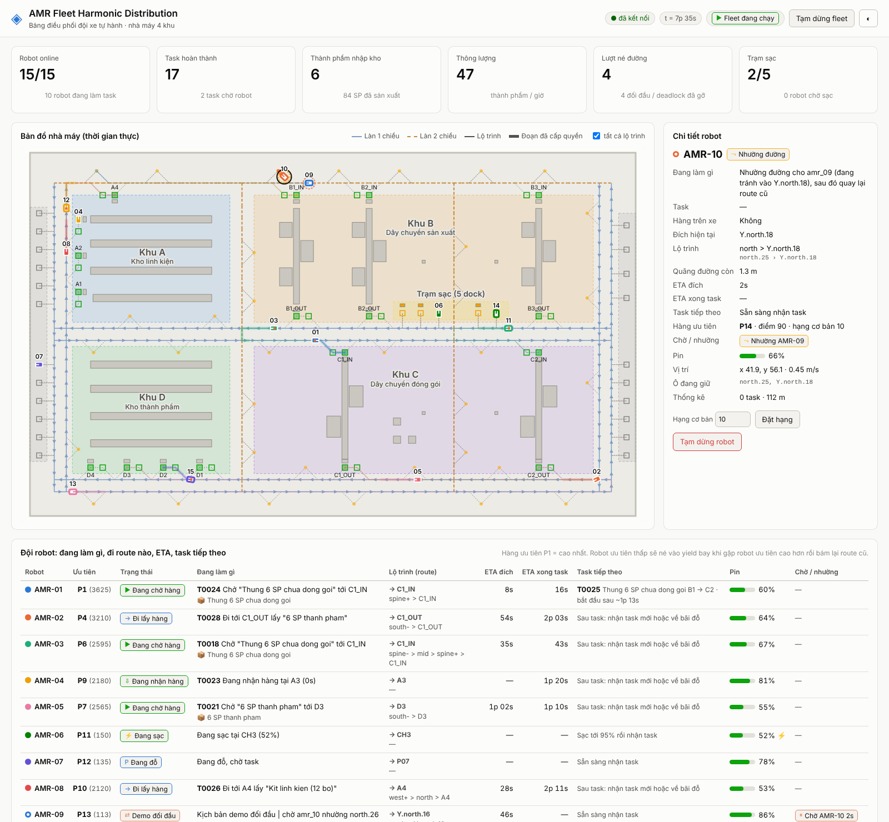
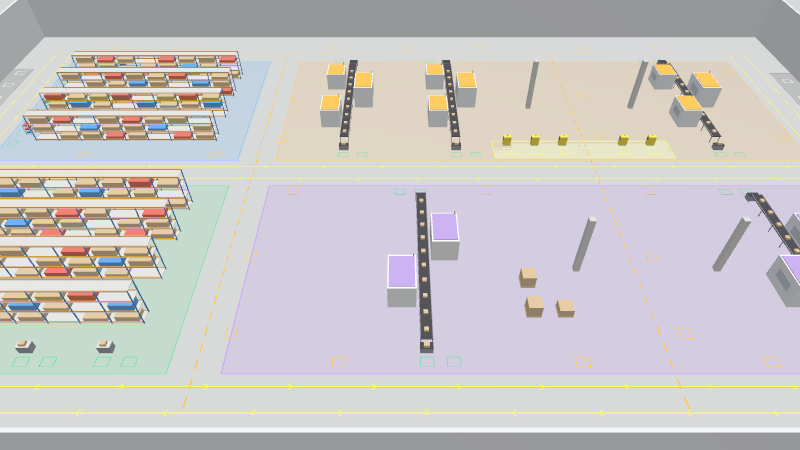
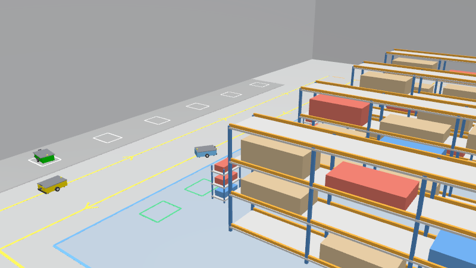
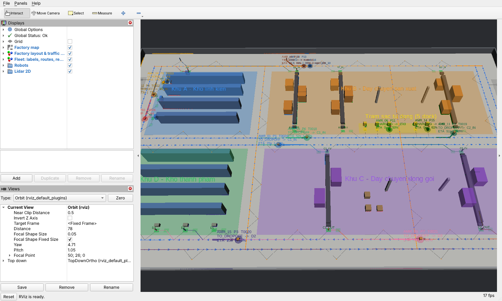

# AMR Fleet Harmonic Distribution

Mô phỏng **đội 10–15 AMR (tối đa 22)** vận chuyển nội bộ trong một nhà máy 100 m × 60 m, chạy trên
**ROS 2 Jazzy + Gazebo Harmonic** (tương thích Jetty) và **RViz2**. Hệ thống có:

* **Fleet manager**: giao task theo dây chuyền sản xuất mô phỏng (MES), điều phối giao thông
  thông minh theo hàng ưu tiên, né đường rồi bám lại route cũ, gỡ deadlock, quản lý trạm sạc.
* **Dashboard web** (http://localhost:8080): xem robot số mấy đang làm gì, đi route nào, ETA,
  task tiếp theo, hàng ưu tiên, pin, đang chờ hoặc nhường ai. Có thêm bản đồ trực tiếp và nhật ký điều phối.



| Gazebo Harmonic: toàn cảnh nhà máy | Gazebo: AMR tại kệ linh kiện khu A, làn và ô đỗ |
|---|---|
|  |  |



| Yêu cầu | Cách đáp ứng |
|---|---|
| Fleet ≥ 10–15 AMR | `num_robots:=12` (mặc định), đã kiểm thử 15. Có 22 chỗ đỗ nên tối đa 22 robot |
| 1 trạm sạc tự động cho ≥ 5 robot | Trạm sạc 5 dock (CH1–CH5) ở trung tâm, có hàng đợi sạc và cơ chế nhường dock |
| Nhà máy rộng, 4 khu | Khu A kho linh kiện · Khu B dây chuyền sản xuất (3 line) · Khu C dây chuyền đóng gói (2 line) · Khu D kho thành phẩm |
| Chu trình sản xuất | A (kit linh kiện) → B_IN → line SX → SP chưa đóng gói xếp vào **thùng** ở B_OUT → C_IN → đóng gói từng SP → C_OUT → D |
| Hoạt động hài hoà, điều khiển mạng lưới thông minh | Đồ thị giao thông làn 1 chiều + làn 2 chiều có yield bay, đặt chỗ node, cấm dừng trong giao lộ, định tuyến tránh ùn tắc, gỡ deadlock |
| 2 bánh chủ động + 4 bánh tự do, lidar 2D, camera 3D | URDF `amr_description`: diff-drive, 4 caster, `gpu_lidar` 180°, `rgbd_camera` (ảnh + depth + point cloud) |
| Xem robot số mấy làm gì, route nào, ETA, task tiếp theo | Dashboard web, nhãn trong RViz, `fleet_cli status`, topic `/fleet/state` |
| Hàng ưu tiên, đụng nhau thì robot ưu tiên thấp né rồi bám lại route cũ | Xếp hạng P1..Pn mỗi chu kỳ. Robot ưu tiên thấp tránh vào yield bay, chờ robot ưu tiên cao đi qua rồi nhập lại **route cũ** |

---

## 1. Kiến trúc

```
                 ┌───────────────────────── amr_bringup ──────────────────────────┐
                 │ factory_layout.yaml (nguồn dữ liệu duy nhất)  fleet_params.yaml │
                 └──────────────┬──────────────────────────────┬──────────────────┘
                                │                              │
   Gazebo Harmonic  ◄── generate_world (SDF)          fleet_manager (amr_fleet_manager)
   15 × AMR (URDF)                                     ├─ MES mô phỏng → task
   ros_gz_bridge  ──/amr_XX/odom, scan, camera──►      ├─ phân task + "task tiếp theo"
        ▲                                              ├─ traffic control (đặt chỗ node, ưu tiên,
        │ /amr_XX/cmd_vel                              │   né + bám lại route cũ, deadlock)
   robot_agent ×N  ◄──/amr_XX/fleet/route────────────  ├─ quản lý pin / trạm sạc 5 dock
   (bám đường + vùng an toàn lidar + pin) ──status──►  └─ /fleet/state, /fleet/markers, /map …
                                                                 │
                                         RViz2 ◄─────────────────┤
                                         dashboard (web :8080) ◄─┘ /fleet/snapshot_json
```

| Package | Nội dung |
|---|---|
| `amr_fleet_msgs` | Message/service: `RouteCommand`, `RobotStatus`, `RobotState`, `FleetState`, `TaskInfo`, `ProductionState`, `FleetEvent`, `SubmitTask`, `SetRobotPriority` |
| `amr_description` | URDF/xacro của AMR + plugin Gazebo (DiffDrive, OdometryPublisher, JointStatePublisher, gpu_lidar, rgbd_camera) |
| `amr_gazebo` | Launch Gazebo: sinh world từ layout, spawn N robot, một `ros_gz_bridge` chung cho cả đội |
| `amr_fleet_manager` | Lõi điều phối (Python thuần, có unit test), node ROS: `fleet_manager`, `robot_agent`, `kinematic_sim`, `dashboard`, công cụ `fleet_cli`, `headless_sim`, `generate_world`, `rviz_config` |
| `amr_bringup` | `bringup.launch.py`, `fleet.launch.py`, layout nhà máy, tham số |

Lõi `amr_fleet_manager/core` **không phụ thuộc ROS**: cùng một mã được dùng trong node ROS, trong mô phỏng
headless và trong unit test.

## 2. Nhà máy và chu trình sản xuất

```
 y=60 ┌──────────────────────────── tường ──────────────────────────────────────┐
      │ P  ═══════════ Đường Bắc 2 CHIỀU (yield bay phía bắc) ════════════════ P│
      │ A  A4      B1_IN        B2_IN       ┆link 2 chiều    B3_IN             P│
      │ r ┌─Khu A──────┐ ┆ ┌──── Khu B: 3 dây chuyền sản xuất (băng tải + máy) ┐│
      │ k │ kệ linh kiện│ ┆ │  B1          B2              ┆        B3          ││
      │ A1│             │ ┆ │                              ┆                    ││
      │ A2│             │ ┆ │          [CH5 CH4 CH3 ┆ CH2 CH1] trạm sạc         ││
      │ A3└─────────────┘ ┆ └ B1_OUT ─── B2_OUT ───────────┆──────── B3_OUT ────┘│
      │ ══════════ Trục chính: 2 làn 1 chiều (Tây ← y=31, Đông → y=29) ════════ │
      │ P ┌─Khu D──────┐ ┆ ┌ C1_IN ──── Khu C: 2 dây chuyền đóng gói ── C2_IN ┐P│
      │ P │ kệ thành   │ ┆ │  C1                          ┆          C2        │P│
      │ P │ phẩm       │ ┆ │                              ┆                    │P│
      │ P └ D4 D3 D2 D1┘ ┆ └ C1_OUT ──────────────────────┆─────────  C2_OUT ──┘ │
      │ ══════════ Đường Nam: 2 làn 1 chiều ════════════════════════════════════│
 y=0  └─ x=0 ──── Đường Tây (2 làn) ── Trục giữa x=35 (2 chiều) ─── Đường Đông (2 làn) ─ x=100
```

* **Làn 1 chiều theo luật đi bên phải** (Đường Nam, Trục chính, Đường Tây, Đường Đông): hai làn cách nhau
  2 m nên không có đối đầu. Có mũi tên chỉ chiều trong Gazebo và RViz.
* **Làn 2 chiều** (Đường Bắc, Trục giữa x=35, Ngõ tắt x=70) có **yield bay** (ô tránh) dọc làn. Đây là nơi
  robot gặp nhau đối đầu và robot ưu tiên thấp phải né.
* **Trạm** là lay-by bên phải làn: `làn → Q (ô chờ) → S (ô phục vụ) → làn`. Robot chờ trạm luôn đứng ở Q,
  không bao giờ chặn làn.

**Chu trình (MES mô phỏng, `process:` trong layout):**

1. `KIT_DELIVERY` A1–A4 → B*_IN: kit linh kiện (12 bộ) cho dây chuyền sản xuất.
2. Mỗi dây chuyền B làm ra 1 SP sau mỗi `cycle_time`. SP chưa đóng gói được **xếp vào thùng** (6 SP/thùng).
   Thùng đầy nằm ở buffer B*_OUT.
3. `BOX_TRANSFER` B*_OUT → C*_IN: chở thùng sang dây chuyền đóng gói, chọn line C đang ít việc nhất.
4. Dây chuyền C **đóng gói từng sản phẩm** (`pack_time`/SP) và đưa lên pallet thành phẩm.
5. `FG_DELIVERY` C*_OUT → D1–D4: nhập kho thành phẩm.

Task được nâng ưu tiên (HIGH) khi dây chuyền sắp **thiếu đầu vào** hoặc **nghẽn đầu ra**.

## 3. Robot AMR

| Thành phần | Thông số |
|---|---|
| Kích thước | 0.80 × 0.56 m, sàn chở hàng cao 0.29 m, 45 kg |
| Truyền động | 2 bánh chủ động Ø160 mm ở giữa thân (vi sai, cách nhau 0.52 m) + **4 bánh tự do** ở 4 góc |
| Lidar 2D | `gpu_lidar` phía trước, cao 0.20 m, 180°, 361 tia, 0.08–20 m, 10 Hz → `/amr_XX/scan` |
| Camera 3D | `rgbd_camera` 320×240, 5 Hz → `/amr_XX/camera/{image,depth_image,points,camera_info}` |
| Odometry | `OdometryPublisher` (trùng khung map, thay cho định vị) → `/amr_XX/odom`, TF `amr_XX/odom → amr_XX/base_footprint` |
| Tốc độ | 1.0 m/s trên làn, 0.45 m/s trong lay-by/dock, quay tại chỗ khi lệch hướng lớn |
| An toàn | Vùng cảnh báo 0.85 m (giảm tốc), vùng bảo vệ 0.30 m (dừng) theo lidar, góc ±35° |

## 4. Điều phối giao thông (cốt lõi)

Mỗi chu kỳ 10 Hz, `core/traffic.py` và `core/fleet.py` làm các bước sau:

1. **Ô đang giữ (held)**: gồm node robot đang đứng, node nó đang đi tới và mọi node robot không kịp
   phanh trước đó. Đây là khoá cứng, robot nào giữ thì robot đó sở hữu.
2. **Cấp quyền đi (grant)** cho từng robot **theo thứ tự ưu tiên giảm dần**. Robot được cấp tiếp từng node
   dọc route (khoảng 4.5 m phía trước). Một node chỉ trống khi mọi node trong bán kính 1.3 m và mọi node bị
   cạnh đi quét qua đều không thuộc robot khác. **Giao lộ được cấp nguyên khối** gồm cả node ra khỏi giao
   lộ, nên không robot nào dừng giữa giao lộ.
3. **Đồ thị chờ (wait-for)**: ghi lại robot nào đang bị robot nào chặn.
   * **Đối đầu / deadlock vòng** (A chờ B, B chờ A, hoặc vòng dài hơn): robot **ưu tiên thấp nhất** trong
     vòng phải né.
   * **Chặn ưu tiên**: robot ưu tiên cao bị một robot ưu tiên thấp đang đứng yên chặn quá 3 s. Nếu robot
     thấp tránh ra thì robot cao đi được, nên robot thấp phải nhường.
4. **Né đường**: tìm nơi tránh gần nhất (yield bay, ô đỗ trống hoặc làn khác) nằm **ngoài lộ trình sắp
   tới** của robot ưu tiên cao và không chạm robot khác. Robot thấp đi vào đó và chờ tới khi robot ưu tiên
   cao đã đi qua.
5. **Bám lại route cũ**: từ chỗ tránh, chọn node trên **route ban đầu** sao cho
   (đường quay lại + phần route cũ còn lại) ngắn nhất. Robot đi ra node đó và tiếp tục đúng route và
   nhiệm vụ cũ, ví dụ log: `amr_05 bám lại route cũ tại north.16 → tiếp tục đi tới điểm lấy hàng`.
6. **Đổi lộ trình**: robot bị kẹt quá 20 s sẽ được lập lại đường đi tránh vùng tắc. Bộ lập đường A* cũng
   phạt các node đang có robot đứng, nên robot chủ động đi vòng chỗ đông.

**Hàng ưu tiên** (`priority_mode: dynamic`, tính lại mỗi chu kỳ, hiển thị P1..Pn):

```
điểm = 1000·(mức ưu tiên task + 1)          (task đang làm; HIGH khi dây chuyền sắp dừng)
     + 400   nếu đang chở hàng
     + 600   nếu đang đi sạc (3500 nếu pin < 15 %)
     + 15·(N + 1 − hạng cơ bản)              (hạng cơ bản: amr_01 = 1, đổi được trên dashboard)
     + 4·thời gian đã chờ (tối đa 160)       (chống "chết đói" ở giao lộ)
```

Khi quyết định ai phải né, hệ thống dùng điểm **không** cộng thời gian chờ để tránh lật kèo qua lại.
`priority_mode:=static` thì chỉ dùng hạng cơ bản (AMR-01 luôn cao nhất).

## 5. Pin và trạm sạc

* Pin được mô phỏng trên robot (`robot_agent`): tiêu hao khi đứng yên và khi chạy, sạc 0.25 %/s trên dock.
* Pin < 30 %: làm xong task hiện tại rồi đi sạc, huỷ "task tiếp theo" nếu có.
  Pin < 15 % khi đang chạy rỗng: huỷ task, trả task về hàng đợi rồi đi sạc ngay.
* Rảnh và pin < 50 % mà có dock trống gần thì **sạc tranh thủ**. Robot sạc tranh thủ nhường dock cho robot
  pin thấp, và được gọi đi làm task khi pin ≥ 60 % (robot vào sạc vì pin thấp thì phải ≥ 80 %).
* Hết dock trống: robot vào **hàng đợi sạc** (ưu tiên pin thấp nhất) và chờ ở bãi đỗ gần trạm sạc.

## 6. Cài đặt

Ubuntu 24.04 + ROS 2 Jazzy (đi kèm Gazebo Harmonic qua `ros_gz`):

```bash
sudo apt install ros-jazzy-desktop ros-jazzy-ros-gz ros-jazzy-xacro \
     ros-jazzy-robot-state-publisher ros-jazzy-joint-state-publisher python3-colcon-common-extensions
mkdir -p ~/amr_ws && cd ~/amr_ws
git clone <repo này> src/AMR-fleet-harmonic-distribution     # hoặc copy thư mục src/
source /opt/ros/jazzy/setup.bash
colcon build --symlink-install
source install/setup.bash
```

**Gazebo Jetty**: các system dùng tên `gz-sim-*-system` và thẻ `gz_frame_id` giống Harmonic, nên chỉ cần
build workspace trên bản ROS 2 đi kèm Jetty (ví dụ Lyrical/Rolling với `ros_gz` tương ứng). Không cần sửa mã.

## 7. Chạy

```bash
# Gazebo Harmonic + RViz + dashboard, 12 robot
ros2 launch amr_bringup bringup.launch.py num_robots:=12

# 15 robot, không mở GUI Gazebo (vẫn render cảm biến), chỉ bridge camera của amr_01
ros2 launch amr_bringup bringup.launch.py num_robots:=15 gui:=false

# Máy yếu / không GPU: bỏ Gazebo, dùng bộ mô phỏng động học (cùng topic, cùng fleet software)
ros2 launch amr_bringup bringup.launch.py sim:=kinematic num_robots:=15

# Ưu tiên tĩnh theo số hiệu robot
ros2 launch amr_bringup bringup.launch.py priority_mode:=static
```

Mở **http://localhost:8080** để xem dashboard.

### Xem robot né đường ngay

Trong vận hành bình thường, làn 1 chiều và định tuyến tránh ùn tắc khiến các cuộc đối đầu ít xảy ra (đó là
mục tiêu của mạng lưới). Để xem tận mắt cơ chế né, bấm **"Demo né đường"** trên dashboard hoặc chạy
`ros2 run amr_fleet_manager fleet_cli demo`. Hai robot rảnh được đưa ra hai đầu Đường Bắc (làn 2 chiều) rồi
chạy ngược chiều cùng lúc. Robot có hạng ưu tiên thấp hơn tránh vào yield bay, chờ robot kia đi qua rồi
**bám lại route cũ**. Mọi bước được ghi vào nhật ký với nhãn "Né đường".

| Tham số | Mặc định | Ý nghĩa |
|---|---|---|
| `sim` | `gazebo` | `gazebo` hoặc `kinematic` |
| `num_robots` | `12` | 1..22 (khuyến nghị 10–15) |
| `gui` | `true` | GUI Gazebo |
| `rviz` | `true` | RViz2 với cấu hình sinh tự động cho N robot |
| `camera` | `true` | Mô phỏng camera RGB-D trên mọi robot |
| `bridge_cameras` | `first` | `none` · `first` · `all`: camera nào được đưa sang ROS |
| `priority_mode` | `dynamic` | `dynamic` · `static` |
| `production` | `true` | `false`: tắt MES mô phỏng, robot chỉ chạy task thủ công / demo |
| `agents` | `single_process` | `single_process`: mọi agent trong 1 process, nhẹ CPU khi mô phỏng · `per_robot`: mỗi robot 1 process như trên AMR thật |
| `dashboard_port` | `8080` | Cổng web |

### Công cụ dòng lệnh

```bash
ros2 run amr_fleet_manager fleet_cli status              # bảng trạng thái trực tiếp trong terminal
ros2 run amr_fleet_manager fleet_cli task A2 D1 --priority 3
ros2 run amr_fleet_manager fleet_cli rank amr_07 1       # cho amr_07 hạng ưu tiên cơ bản cao nhất
ros2 run amr_fleet_manager fleet_cli pause | resume
ros2 run amr_fleet_manager fleet_cli demo                # kịch bản đối đầu → né → bám lại route cũ
ros2 run amr_fleet_manager fleet_cli pause_robot amr_03
ros2 run amr_fleet_manager headless_sim --robots 15 --minutes 60   # mô phỏng nhanh không ROS/Gazebo
```

### RViz

Cấu hình RViz được sinh tự động: bản đồ, layout (khu, máy, làn và chiều đi, trạm, dock, yield bay),
model từng robot, lidar mỗi robot (màu theo robot), point cloud và ảnh camera 3D của `amr_01`. Nhãn trên
mỗi robot có dạng:

```
AMR-05 P2 T0012
TO_DROPOFF -> B1_IN
ETA 34s | 72% | YIELD->amr_02
```

Lộ trình còn lại vẽ nét mảnh, đoạn đã được cấp quyền vẽ nét đậm. Ô vuông màu là các node robot đang giữ,
hộp nâu trên robot nghĩa là đang chở hàng.

## 8. Giao diện ROS

| Topic / service | Kiểu | Mô tả |
|---|---|---|
| `/fleet/state` | `amr_fleet_msgs/FleetState` | Toàn bộ robot (trạng thái, task, route, ETA, task kế tiếp, ưu tiên, chờ/nhường), task, trạm sạc |
| `/fleet/production` | `amr_fleet_msgs/ProductionState` | Trạng thái các dây chuyền, buffer, KPI |
| `/fleet/events` | `amr_fleet_msgs/FleetEvent` | Nhật ký: giao task, né đường, deadlock, sạc… |
| `/fleet/markers`, `/fleet/static_markers`, `/map` | RViz | Nhãn, route, ô đặt chỗ, layout, bản đồ |
| `/amr_XX/fleet/route` | `RouteCommand` | Fleet → robot: waypoint + chỉ số được cấp quyền |
| `/amr_XX/fleet/status` | `RobotStatus` | Robot → fleet: vị trí, tiến độ, pin, an toàn |
| `/amr_XX/cmd_vel`, `/odom`, `/scan`, `/camera/*`, `/battery` | chuẩn | Giao diện robot |
| `/fleet/submit_task` | `SubmitTask` | Tạo task thủ công |
| `/fleet/set_robot_priority` | `SetRobotPriority` | Đổi hạng ưu tiên cơ bản / tạm dừng robot |
| `/fleet/pause` | `std_srvs/SetBool` | Tạm dừng / tiếp tục cả đội |
| `/fleet/demo_head_on` | `std_srvs/Trigger` | Kịch bản demo: 2 robot đối đầu trên Đường Bắc |

## 9. Tuỳ biến nhà máy

Mọi thứ nằm trong `src/amr_bringup/config/factory_layout.yaml`: kích thước, các aisle (`dual` hoặc
`single`), khu, trạm (lay-by), dock sạc, bãi đỗ, vật thể (kệ, băng tải, máy…) và thông số sản xuất. World
Gazebo được **sinh lại mỗi lần launch**, nên đồ thị giao thông, world 3D, bản đồ RViz và dashboard luôn
khớp nhau. Để xuất file SDF riêng:

```bash
ros2 run amr_fleet_manager generate_world --layout src/amr_bringup/config/factory_layout.yaml --out factory.sdf
```

## 10. Kiểm thử

```bash
cd src/amr_fleet_manager && python3 -m pytest -q test      # hoặc: colcon test --packages-select amr_fleet_manager
```

Test bao gồm: dựng đồ thị (liên thông, không ngõ cụt), bộ bám đường, vùng an toàn, kịch bản **đối đầu trên
làn 2 chiều** (robot ưu tiên thấp vào yield bay, chờ, bám lại route cũ, cả hai về đích không va chạm),
và mô phỏng 12–15 robot với tiêu chí 0 va chạm (kiểm tra va chạm hình chữ nhật xoay) và không robot nào
kẹt quá 150 s.

Kết quả mô phỏng headless 30 phút (cấu hình mặc định):

| Robot | Task xong | Thành phẩm nhập kho | Dây chuyền SX chạy | Va chạm | Né đường (đối đầu đã gỡ) |
|---|---|---|---|---|---|
| 12 | ~100 | ~200 | 79–97 % | 0 | 0–2 |
| 15 | ~100 | ~200 | 83–94 % | 0 | 7 |

Đã chạy thử trên **Gazebo Harmonic (gz-sim 8)** với 3–6 robot (container không GPU, render phần mềm):
robot spawn tại bãi đỗ, lidar `gpu_lidar` và camera RGB-D xuất dữ liệu, odometry trùng khung map, robot bám làn
sai số khoảng 1 cm, hoàn thành chu trình lấy → chở → trả. Kịch bản đối đầu cũng chạy đúng trên vật lý Gazebo:
AMR-03 (P3) tránh vào `Y.north.18`, AMR-02 (P2) đi qua, rồi AMR-03 bám lại route cũ tại `north.40`.
Khoảng cách vật cản tính từ point cloud camera khớp lidar trong ±1 cm.

## 11. Hiệu năng và lưu ý

* 15 robot × (lidar + camera RGB-D) trong Gazebo cần GPU. Trên máy yếu, có thể dùng `camera:=false`,
  `bridge_cameras:=none` hoặc giảm `camera_rate`, hoặc chạy `sim:=kinematic`.
* Để nhẹ CPU, mặc định tất cả `robot_agent` chạy trong 1 process (`fleet_agents`) và mọi
  `robot_state_publisher` nằm trong 1 component container: 15 agent chỉ tốn khoảng 0.6 lõi CPU.
* Định vị dùng odometry "ground truth" của Gazebo (khung `map` ≡ khung world). Muốn dùng AMCL hay SLAM thì
  chỉ cần thay nguồn `/amr_XX/odom` cho `robot_agent` mà không phải sửa fleet manager.
* Lidar dùng cho vùng an toàn cục bộ, còn tránh va chạm giữa các robot do fleet manager đảm bảo bằng đặt chỗ node.
